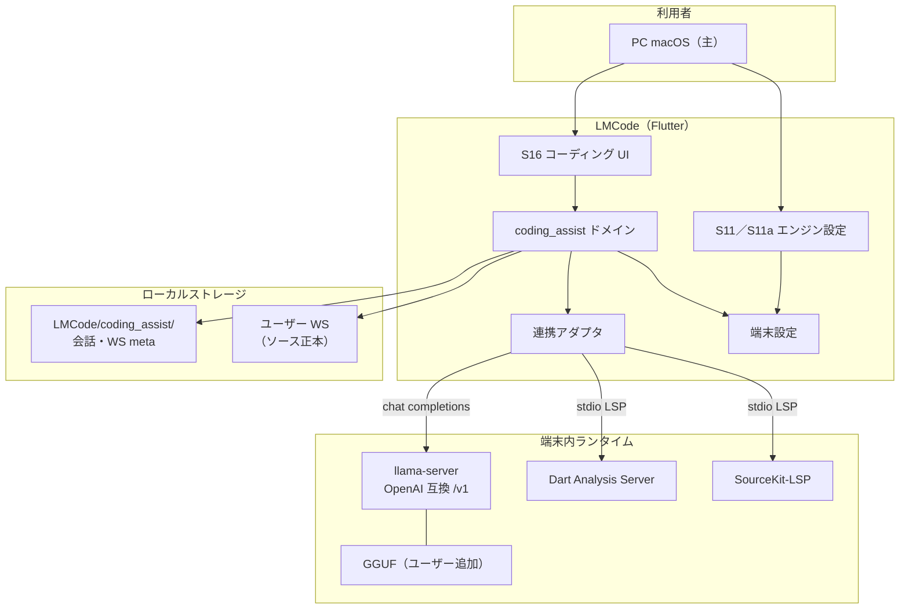
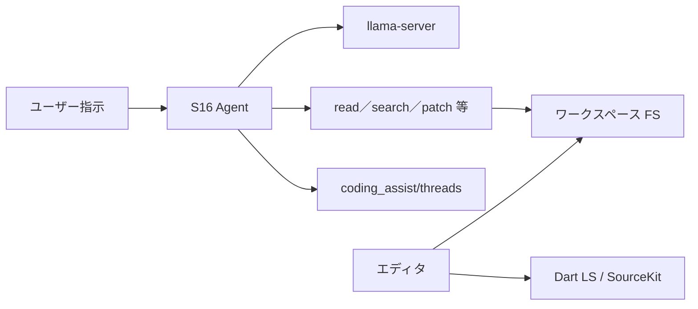

# 基本設計：システム構成

最終更新: 2026-10-27  
正本: 本ファイル。関連方針は `00_概要とスコープ.md`。

---

## 1. 全体像（一言）

**Flutter デスクトップクライアント（LMCode）**を中心に、端末内の **ローカル LLM（llama.cpp `llama-server`）** と（任意）**言語サーバ（Dart Analysis Server／SourceKit-LSP）** を子プロセスとして起動し、会話・索引は **ローカル `LMCode/coding_assist/`** に、ソース正本は **ユーザーが開いたワークスペース** に置く。  
自前バックエンドなし。

---

## 2. 論理構成図



---

## 3. コンポーネント責務

| 区分 | コンポーネント | 責務 |
|------|----------------|------|
| クライアント | Flutter アプリ | S16 UI、Agent ループ、パッチ適用、ターミナル、サイドカー起動・監視 |
| LLM | `llama-server` + GGUF | コーディング Agent（stream）。用途はコーディングのみ |
| Dart LS | Analysis Server | Flutter／Dart の入力中補完（WS オープン時） |
| SourceKit | SourceKit-LSP | Swift 入力中補完・定義吹き出し |
| 永続化 | ローカル FS | `LMCode/coding_assist/`（会話・meta）。ソースは WS |
| 設定 | SharedPreferences 等 | LLM ホスト／ポート／モデル／ctx／thinking、Dart SDK パス、S16 UI 設定 |

---

## 4. 配置構成（ワンパッケージ目標）

```text
[インストーラ成果物]
├── lmcode.app / lmcode.exe 等
└── local_llm/
    ├── llama-server     … OS 別バイナリ（同梱可）
    └── models/*.gguf    … ユーザーが追加（同梱しない）
```

| 項目 | 方針 |
|------|------|
| 目標 | エンドユーザーが別途 Ollama を用意しなくてよい |
| GGUF | **同梱しない**。S11a で取り込み。ライセンスは利用者責任 |
| 展開先 | ユーザー領域の `LMCode/local_llm/` 等 |
| ポート | LLM は localhost。衝突時は起動失敗を明示（自動ポート探索しない） |

---

## 5. データ／処理の流れ（概要）



* 生成AI OFF または LLM 未起動時: エディタ・ターミナル・ファイル操作は継続。Agent 送信は不可。
* ソースの正本は常にワークスペース側。`coding_assist/` にソース全文は蓄積しない。

---

## 6. 外部インタフェース概要

| 接続先 | プロトコル | 認証 | 位置づけ |
|--------|------------|------|----------|
| llama-server | HTTP localhost（OpenAI 互換） | なし | 必須（Agent 利用時） |
| Dart Analysis Server | stdio LSP | なし | 任意（Dart／Flutter WS） |
| SourceKit-LSP | stdio LSP | なし | 任意（Swift／Xcode WS） |

詳細は `document/詳細設計/IF/`。

---

## 7. OS 差分（構成観点）

| 領域 | macOS | Windows |
|------|-------|---------|
| アプリ | Flutter desktop | 同左 |
| S16 入口 | ○（起動画面） | ○（起動画面） |
| LLM | 同一 GGUF／同一 API | バイナリのみ分岐（`llama-server.exe`） |
| Dart LS | ○ | ○ |
| SourceKit | ○（Xcode 前提） | × |

機能差分の一覧は `04_非機能制約OS差分.md`。

---

## 8. 版履歴

| 日付 | 内容 |
|------|------|
| 2026-10-27 | lmcode 切り出し。LLM＋言語サーバ中心に再定義 |
