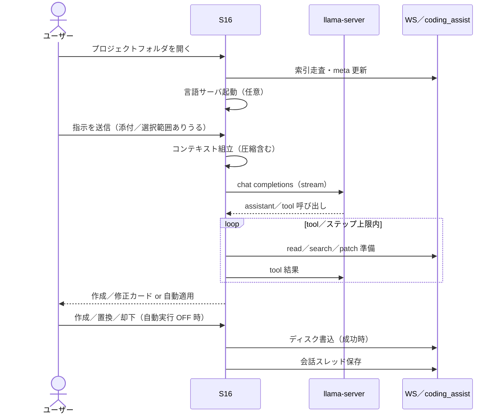

# 基本設計：主要シーケンス

最終更新: 2026-10-27  
画面レイアウト・画面IDは詳細設計。ここでは **処理の順序と分岐** のみを正とする。

---

## 1. フェーズ概観

```text
[起動] → [WS オープン] → [編集／Agent] → [設定（任意）]
```

| フェーズ | 主な処理 |
|----------|----------|
| 起動 | S16 表示。生成AI ON なら `llama-server` 起動／health |
| WS オープン | フォルダ選択、索引走査、`CodingWorkspaceKind` 判定、（言語に応じ）LS 起動 |
| 編集／Agent | 手編集・ターミナル・Agent 送信・tool・パッチ適用・（Flutter）自動検証 |
| 設定 | S11／S11a（モデル／ctx／Dart SDK）。S16 から push |

---

## 2. 標準フロー（Agent 1往復）



詳細の Agent 契約・自動実行・Flutter 自動検証は **S16** を正とする。

---

## 3. 起動〜準備

| ステップ | 内容 |
|----------|------|
| 1 | アプリ起動 → 初期ルート `/coding-assist`（S16） |
| 2 | ベースフォルダ未設定なら既定（Documents 等）を使い `LMCode/` を確保 |
| 3 | 生成AI ON なら `llama-server` 起動・モデル未設定時は案内 |
| 4 | 直近ワークスペースがあれば案内／再開可（詳細は S16） |

Windows で UI 非提供のときは設定（S11）へリダイレクト（実装: `routes.dart`）。

---

## 4. モデル切替・設定保存

| ステップ | 内容 |
|----------|------|
| 1 | S16 ツールバーまたは S11 でコーディング用モデル／ctx／thinking を変更 |
| 2 | 保存〜`llama-server` 再起動（ブロッキングオーバーレイ） |
| 3 | health 成功で送信可能に戻す。失敗は明示 |

Dart SDK パス変更は Analysis Server の再起動で反映（S11 §4.6／IF_Dart）。

---

## 5. 異常・切断

| 事象 | 方針 |
|------|------|
| LLM 切断 | Agent 送信不可。エディタ作業は継続。再起動／接続テストは S11 |
| LS 切断 | 補完のみ不可。Agent は継続可 |
| 異常終了 | 直近保存済みスレッドは `coding_assist/threads` に残る。未保存タブは OS／アプリの通常扱い |

---

## 6. 関連

* 画面: `document/詳細設計/画面/S16_コーディングアシスト.md`、`S11_エンジン設定.md`
* IF: `document/詳細設計/IF/`

---

## 7. 版履歴

| 日付 | 内容 |
|------|------|
| 2026-10-27 | lmcode 切り出し。コーディングフローのみに再定義 |
