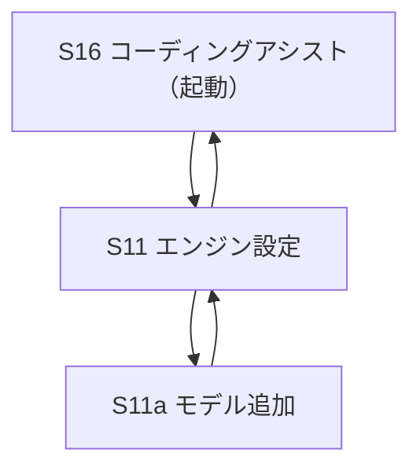

# 詳細設計：画面一覧と遷移

最終更新: 2026-10-27  
本ファイルは **一覧と遷移** まで。各画面の中身は `Sxx_*.md`。

上位: `document/基本設計/02_主要シーケンス.md`  
読み方: `../00_概要と読み方.md`

> **LMCode**: 起動画面は **S16**。残存実装は **S11／S11a／S16**。

---

## 1. 画面マップ



---

## 2. 画面一覧

| ID | 画面名 | 役割 | 詳細ドキュメント | 扱い |
|----|--------|------|------------------|------|
| S16 | コーディングアシスト | プログラム編集・Agent・ターミナル等 | [S16_コーディングアシスト.md](./S16_コーディングアシスト.md) | **起動画面**。macOS のみ（Windows は非提供・GPU 機のみ検討） |
| S11 | エンジン設定 | llama.cpp・Dart SDK パス | [S11_エンジン設定.md](./S11_エンジン設定.md) | S16 から直接遷移 |
| S11a | モデル追加 | GGUF 取り込み・表示名 | [S11_エンジン設定.md](./S11_エンジン設定.md) §4.2.1 | S11 配下 |

### 2.1 共通UI

| 資料 | 内容 |
|------|------|
| [UI共通_モーダル基本系.md](./UI共通_モーダル基本系.md) | 透過黒背景・タイトル帯・キャンセル／OK |

### 2.2 引き継ぎ・検討メモ（S16）

| 資料 | 扱い |
|------|------|
| [S16_引き継ぎ_2026-10-21_自動実行ONのread_file禁止と添付.md](./S16_引き継ぎ_2026-10-21_自動実行ONのread_file禁止と添付.md) | 会話引継ぎの正 |
| [S16_引き継ぎ_2026-10-21_自動実行ONの読み取りループと検査本文.md](./S16_引き継ぎ_2026-10-21_自動実行ONの読み取りループと検査本文.md) | 使わない |
| [S16_引き継ぎ_2026-10-20_自動実行と読み取り上限.md](./S16_引き継ぎ_2026-10-20_自動実行と読み取り上限.md) | 古い。使わない |
| [S16_検討_シンボル探索.md](./S16_検討_シンボル探索.md) | 検討メモ・未採用 |

---

## 3. メインユーザーフロー

```text
S16（起動）→ フォルダを開く → 編集／Agent
         └→ S11 → S11a（モデル追加）→ S11 → S16
```

---

## 4. シェルとレイアウト方針

| 領域 | 方針 |
|------|------|
| デスクトップ既定 | S16 は専用フルレイアウト（共通シェルなし） |
| **画面遷移** | **アニメーションなし**（`NoTransitionPage`） |
| 確認モーダル | [UI共通_モーダル基本系.md](./UI共通_モーダル基本系.md) |

---

## 5. OS 差分（画面露出）

| 機能／画面 | macOS | Windows |
|------------|-------|---------|
| S16 | ○（起動） | ×（ルートは残すが入口無効→S11 へ） |
| S11／S11a | ○ | ○ |

---

## 6. 版履歴

| 日付 | 内容 |
|------|------|
| 2026-10-27 | lmcode 切り出し。S11／S16 のみの遷移図に再定義 |
